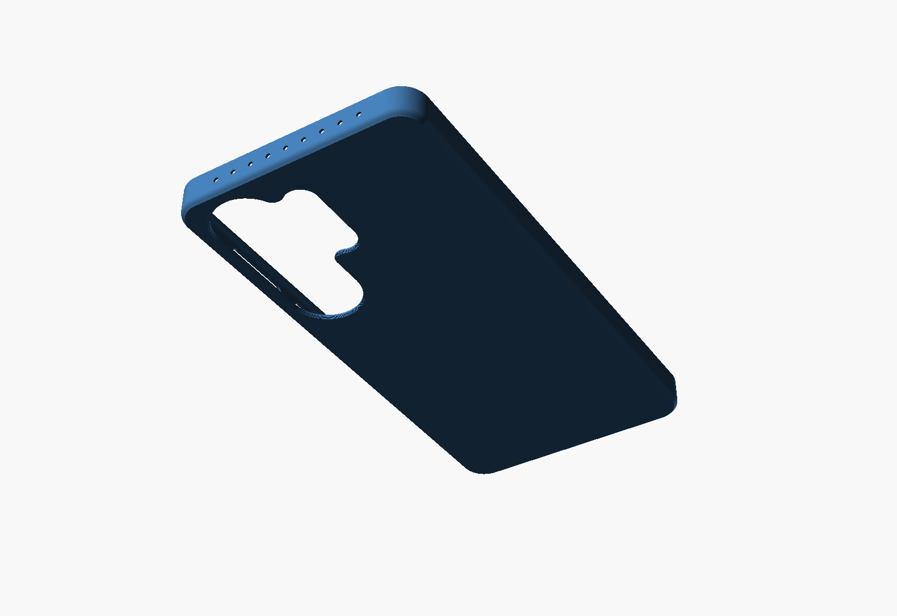
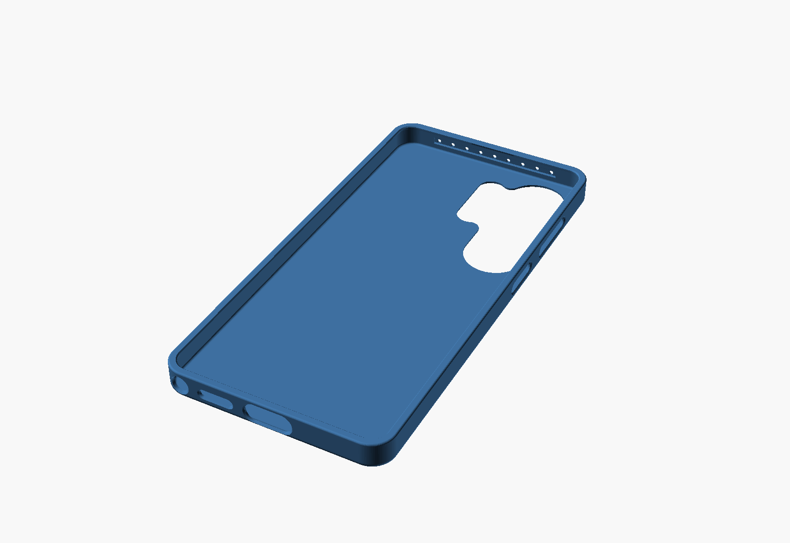
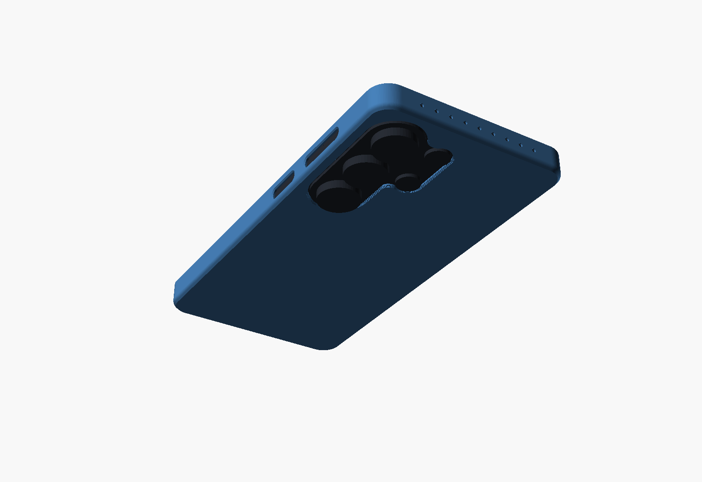
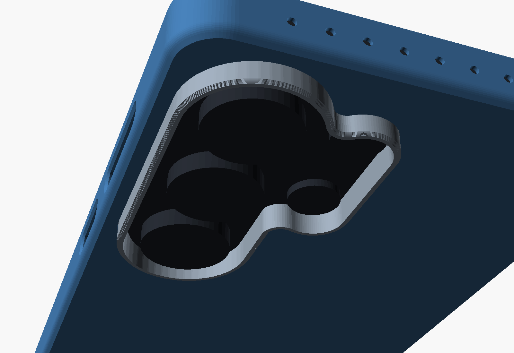
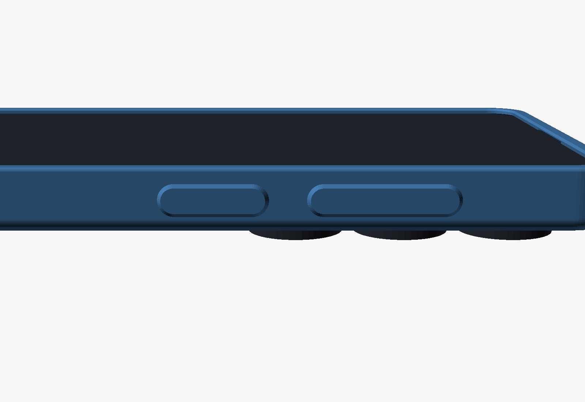
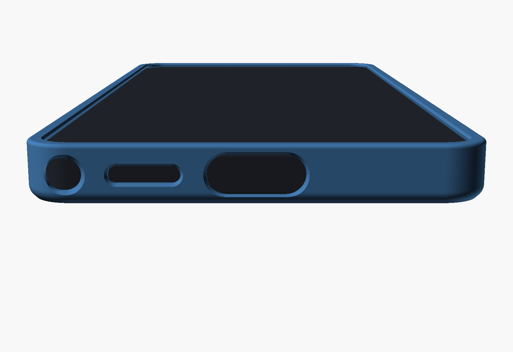
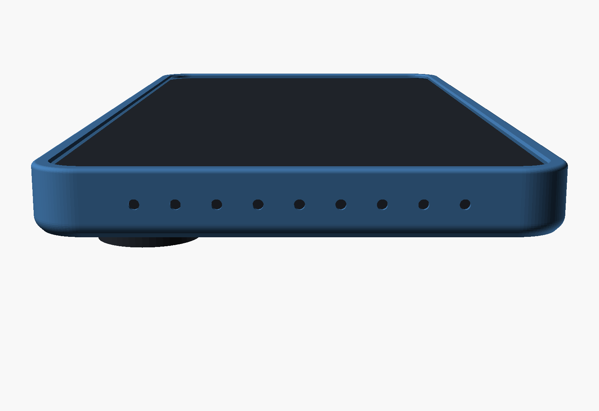
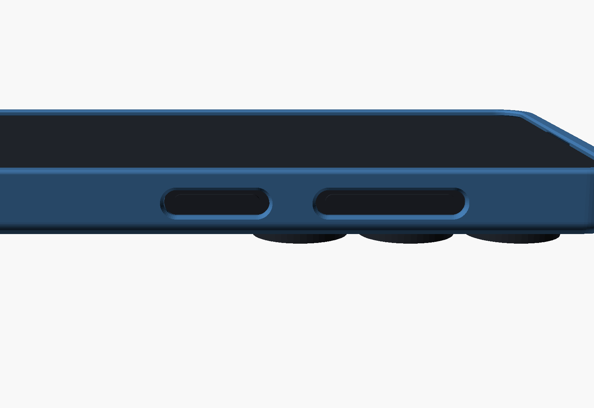

# Galaxy S26 Ultra slim TPU case

A slim, parametric case for the Samsung Galaxy S26 Ultra, designed to be 3D printed in TPU
with no supports. It adds 1.4 mm to each side and 2.5 mm to the thickness, weighs about
24 g, and every dimension can be changed in OpenSCAD's Customizer.

| Back | Inside | On the phone |
|------|--------|--------------|
|  |  |  |

> **Status:** designed and checked in software: watertight meshes, no clash with a phone
> model, and every part sliced in PrusaSlicer. It has not yet been printed and fitted to a
> real phone. Print the fit test first; see [Getting the fit right](#getting-the-fit-right).

## Files

| File | What it is |
|------|------------|
| `stl/s26-ultra-slim-case.stl` | The case, with open key slots. Start here. |
| `stl/s26-ultra-slim-case-covered-keys.stl` | The same case with flexible raised pads over the keys instead of slots. |
| `stl/s26-ultra-slim-case-for-camera-guard.stl` | The case with a larger camera opening and an inner recess for the clip-in guard. |
| `stl/s26-ultra-camera-guard.stl` | Optional clip-in ring that stands 0.4 mm above the lens rings. Needs the case above. |
| `stl/s26-ultra-fit-test.stl` | Skeleton of the case (11.5 g): walls, lip and camera surround, for checking fit before a full print. |
| `s26-ultra-slim-case.scad` | Parametric source. Open in OpenSCAD 2021.01 or newer. |
| `build.sh` | Regenerates the STLs and renders and runs the mesh checks. |
| `check_meshes.py` | The mesh checks: watertightness, wall thickness, overhangs, clashes. |

## Design

**Shell.** 1.2 mm walls and back. The lip stands 1.3 mm proud of the screen and reaches
1.5 mm over its edge, which clears the display (it starts about 2.4 mm in from the edge) and
leaves room for most screen protectors. Corners follow the phone's 7 mm radius. Outside
size: 80.9 x 166.4 x 10.4 mm.

**Camera.** The S26 Ultra's camera is a raised island, about 1.2 mm high, carrying three large
lens rings that stand a further 3.3 mm. Next to it, on the flat back glass, is a column with
the 3x telephoto, flash and laser AF. The case has one opening around both. The 1.2 mm back sits
flush with the top of the island, so only the three big rings stick out, as they do without
a case.

A raised lip around the camera would stick out below the flat back, which is what the case
prints on, so it could only be printed with supports under the whole back plate. Instead
there is an optional **clip-in camera guard** (pictured below). You push it through the camera opening
from inside the case. Its flange drops into a recess and the phone's back glass holds it in
place, so it needs no glue. It stands 0.4 mm above the lens rings. Print it in an opaque,
dark TPU so the flash cannot glow through it into the photos.

| Camera guard | Covered keys |
|--------------|--------------|
|  |  |

**Keys.** The default has open slots with 1.5 mm of margin at each end, so the keys feel
direct. The covered version pushes the wall out 0.6 mm over each key, keeping it 1.2 mm
thick, and leaves the key in a pocket with 0.35 mm of free travel before the pad touches it.
Nothing presses a key while the case is on.

**Bottom edge.** From left to right, seen from the screen:
- The S Pen opening, cut through the curved corner where the pen sits. Press the pen's end to
  eject it as usual.
- The speaker.
- A wide USB-C opening that fits common plug overmoulds and also clears the bottom microphone.

The SIM tray is covered.

**Top edge.** The S26 Ultra has a microphone and a pressure vent on the top edge, and Samsung
says not to cover the vent. Their positions are not published. Rather than guess, the case has
a 0.5 mm deep channel inside the top wall that joins anything within 26 mm of the centre to a
row of nine 1.6 mm vents. Small round holes print cleanly where one long slot would sag.

**Earpiece.** The earpiece is a slit at the top edge of the screen. A shallow pocket under the
lip stops the lip from sealing it.

| Bottom | Top | Keys |
|--------|-----|------|
|  |  |  |

**Printability.** The case prints back-down with no supports.
- The back edge is rounded above a 45-degree chamfer, so the first layers step out no faster
  than 45 degrees.
- The lip's first layer reaches under 1 mm past the layer below.
- The longest bridge is the top of the volume key slot, at 20 mm. The covered-keys version has
  no bridges on the key side at all.
- The camera guard prints flange-down with no overhangs.

## Printing

| Setting | Value |
|---------|-------|
| Filament | TPU 95A (for example Polymaker PolyFlex TPU95, Overture TPU, Bambu TPU 95A HF). Dry it first: 50-55 °C for 4-8 hours. |
| Extruder | Direct drive recommended. On a Bowden printer, use 95A and print slowly. |
| Orientation | As exported: back on the bed, lip up. |
| Supports | Off. |
| Nozzle / layer height | 0.4 mm / 0.2 mm. The lip and key heights are placed on 0.2 mm layer boundaries. |
| Walls | 3 or more wall loops, so the 1.2 mm walls come out as solid perimeters. |
| Bottom and top layers | 6 bottom (the back plate is then fully solid), 5 top. |
| Temperature | Nozzle 220-235 °C (follow your spool's label), bed 40-50 °C. |
| Speed | 20-40 mm/s for standard TPU; high-flow TPU can go faster. Keep volumetric flow within what your TPU is rated for. |
| Cooling | 50-100% after the first layers; 100% for bridges. |
| Retraction | Short: 0.5-1 mm on direct drive. Z-hop off. |
| Bed surface | Textured PEI. On smooth PEI, use glue stick as a release agent: TPU can bond hard enough to tear the sheet. |
| Seam | Aligned or rear, so it lands on a corner. |

With these settings at the slow end of the speed range, PrusaSlicer 2.7 estimates:

| Part | Time | TPU |
|------|------|-----|
| Case | 2 h 50 min | 23.5 g |
| Fit test | 1 h 20 min | 11.5 g |
| Camera guard | 10 min | 1.3 g |

Peel the case off the bed slowly from one corner; don't lever it off by the lip.

## Getting the fit right

1. **Print the fit test first.** It has the full walls, lip and cutouts but only a border of
   the back plate, so it takes about half the time and filament of the case (1 h 20 min,
   11.5 g). Put the phone in
   and check:
   - the grip at the corners;
   - that the lip holds the screen edge;
   - that the keys, USB-C, speaker and S Pen line up;
   - that the camera island and sensor column sit inside the camera opening.
2. **Adjust in OpenSCAD.** Open `s26-ultra-slim-case.scad`, then Window > Customizer.
   | Symptom | Change |
   |---------|--------|
   | Too tight, or the lip lifts at the corners | Raise `fit_xy` by 0.05-0.1 |
   | Loose | Lower `fit_xy` by 0.05 |
   | Phone moves up and down under the lip | Lower `fit_z` from 0.3 to 0.1 (one 0.2 mm layer) |
   | An opening is off | Change its position by the error you measured |
   | Camera island rubs the opening | Raise `cam_clear` |
3. **Export.** Render with F6, then File > Export > STL. Or run `./build.sh`, which regenerates
   every STL and render and runs the checks.

Positions are entered the way you would measure them with calipers:
- **Camera:** looking at the back, measured from the top edge and from the long edge nearest
  the camera (the key edge).
- **Keys:** measured from the phone's top edge.
- **Bottom openings:** measured from the centre line, positive toward the key side as seen from
  the screen, so the S Pen is at -33 mm.

**Putting the phone in.** Slide the camera end in first, press the top corners home, then
roll the lip over the bottom corners. For the camera guard, push it out through the camera
opening from inside the empty case until the flange sits flat in its recess, then fit the
phone.

## Where the dimensions come from

Samsung does not publish accessory drawings for this phone. So the body size and corner radius
are official figures, and most feature positions come from a third-party dataset that measured
Samsung's official product renders at 0.265 mm per pixel. The search results that led to the
dataset described it as matching Samsung's published dimensions to 0.01 mm; I didn't check that
myself. Allow ±0.5 mm on those positions, and up to ±1 mm on the keys and ports.

| What | Value | Confidence | Source |
|------|-------|------------|--------|
| Body | 163.6 x 78.1 x 7.9 mm (thickness excludes the camera) | Official | [Samsung specs][spec], [Samsung compare page][compare], [GSMArena][gsma] |
| Corner radius | 7.0 mm ("7R", the same on all three S26 models) | Official; renders measure 7.3 | [Samsung Design][design] |
| Screen and back edge roll-off | 1.1 mm at the front, 0.7 mm at the back | Estimate from renders | [Mockup dataset][dims] |
| Camera island, lens rings, sensor column | See the Camera section of the `.scad` | Measured from renders, ±0.5 mm | [Mockup dataset][dims] |
| Camera bump | 4.5 mm above the back glass (1.2 island + 3.3 rings) | Renders, matching leaks | [Mockup dataset][dims], [GSMArena leak report][bump] |
| Volume and side keys | 27.0-47.4 mm and 57.6-71.0 mm from the top, 0.45 mm proud | Measured from renders, ±1 mm | [Mockup dataset][dims] |
| Bottom openings | S Pen -33.0, speaker -19.1, USB-C 0, microphone +7.1 mm from centre | Measured from renders, ±1 mm | [Mockup dataset][dims] |
| SIM tray | Bottom edge, key side | Official | [Samsung SIM guide][sim] |
| S Pen | 5.0 x 4.15 mm, push-to-eject | Official | [S Pen specs][spen], [Samsung S Pen support][spen-eject] |
| Top microphone and vent | Present; positions unknown | Official that they exist | [BGR][holes] |
| Qi2 magnets | None built in | Official | [Droid Life][qi2] |

The sources were read through search-engine extracts, because direct page fetches were blocked
while this was researched. [cecilomar's model on Printables][cad] is described as measured with
calipers, and would be a good cross-check if you have it.

## Limitations

- **Not yet test-printed.** Expect to tune `fit_xy`, and possibly one or two openings, after the
  fit test.
- **The camera sticks out.** Without the guard the lens rings stand 3.3 mm proud of the case
  back, and the phone rocks on them on a table, as it does without a case.
- **No Qi2 magnets.** The S26 Ultra has none, and its 25 W magnetic charging needs a magnetic
  case. A stick-on Qi2 ring on the outside of the back works; Samsung warns that magnets can
  interfere with the S Pen.
- **Everyday protection only.** 1.2 mm of TPU guards against scuffs and knocks; it is not a
  rugged, drop-rated case.
- **Simplified phone model.** The phone in the renders and clash checks is simplified: body,
  camera and keys only.

Samsung, Galaxy and S Pen are trademarks of Samsung Electronics. This project is not affiliated
with or endorsed by Samsung.

[spec]: https://www.samsung.com/uk/smartphones/galaxy-s26-ultra/specs/
[compare]: https://www.samsung.com/us/smartphones/galaxy-s26-ultra/compare/
[gsma]: https://www.gsmarena.com/samsung_galaxy_s26_ultra_5g-14320.php
[design]: https://design.samsung.com/global/contents/view/galaxy-s26
[dims]: https://github.com/area-is/react-3d-mockups/blob/f8e4aac2373b4af1c0056c6120fae2f045da3454/packages/react/src/core/devices/galaxy/dimensions.ts
[bump]: https://www.gsmarena.com/ice_universe_the_galaxy_s26_ultra_camera_bump_will_be_almost_twice_as_thick_as_on_the_s25_ultra-news-69415.php
[sim]: https://www.samsung.com/ca/support/mobile-devices/how-to-install-a-usim-card-in-the-samsung-galaxy-s26-series/
[spen]: https://www.samsung.com/au/business/mobile-accessories/galaxy-s26-ultra-s-pen-black-ej-ps948bbegww/
[spen-eject]: https://www.samsung.com/us/support/answer/ANS10010344/
[holes]: https://www.bgr.com/2146951/what-are-the-two-holes-on-top-of-samsung-galaxy-phone-for/
[qi2]: https://www.droid-life.com/2026/02/25/galaxy-s26-ultra-doesnt-have-built-in-qi2-magnets/
[cad]: https://www.printables.com/model/1634811-samsung-galaxy-s26-ultra-model
